README

# 🌱 Rotta — Seu caminho, nossa rotta.

<p align="center">
  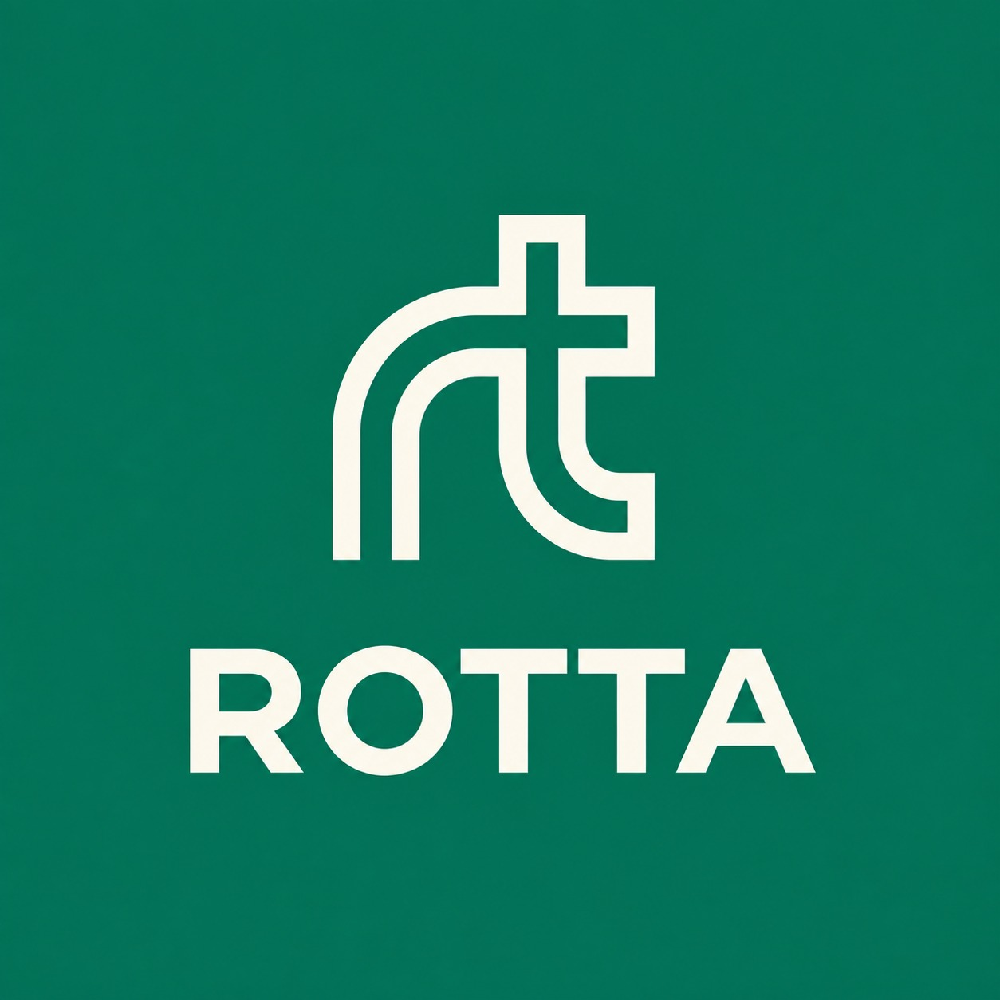
</p>

<p align="center">
  <strong>Transformando atitudes sustentáveis em benefícios para a mobilidade urbana.</strong>
</p>

---

## 🌎 Sobre o projeto

O **Rotta** é uma plataforma desenvolvida para incentivar práticas sustentáveis no dia a dia, conectando ações positivas para o meio ambiente a benefícios relacionados à mobilidade urbana.

A proposta é integrar sustentabilidade e transporte público de forma simples e acessível. O usuário pode registrar ações sustentáveis, acumular pontos e acompanhar seu progresso, com a possibilidade de converter esses pontos em créditos destinados ao transporte público.

O projeto foi desenvolvido como parte do **FIAP Challenge 2026**, em parceria com a **SoulUp**, com foco no desafio de utilização de pontos para transporte público.

## 🎯 Objetivo

O objetivo da Rotta é estimular hábitos sustentáveis por meio de um sistema de recompensas, mostrando que pequenas atitudes podem contribuir para uma cidade mais consciente e sustentável.

Entre as ações incentivadas estão:

- ♻️ Separação de materiais recicláveis;
- 💧 Utilização de garrafas reutilizáveis;
- 🚶 Deslocamento a pé ou de bicicleta;
- 🛍️ Utilização de sacolas reutilizáveis;
- 💡 Economia de energia;
- 🗑️ Descarte correto de resíduos.

## 🚀 Tecnologias utilizadas

O Front-End foi desenvolvido utilizando:

| Tecnologia | Aplicação no projeto |
|---|---|
| React | Construção da interface e componentização |
| Vite | Ambiente de desenvolvimento e build |
| TypeScript | Tipagem estática e organização do código |
| Tailwind CSS | Estilização e responsividade |
| React Router DOM | Navegação entre páginas e rotas protegidas |
| React Hook Form | Gerenciamento e validação de formulários |
| React Icons | Biblioteca de ícones |
| Git | Controle de versão |
| GitHub | Hospedagem do repositório e colaboração |

## 🖥️ Funcionalidades

### Autenticação

- **Login:** autenticação de usuários por e-mail e senha, com comunicação com a API Java.
- **Cadastro:** criação de conta com nome, e-mail, CPF, telefone e senha.
- **Recuperação de senha:** verificação do e-mail cadastrado e redefinição de senha.
- **Rotas privadas:** controle de acesso às páginas internas da aplicação.
- **Logout:** encerramento da sessão local do usuário.

### Páginas da aplicação

| Página | Descrição |
|---|---|
| Home | Apresentação da plataforma e de sua proposta. |
| Sobre | Informações sobre o projeto, seus objetivos e sua importância. |
| Solução | Apresentação da solução proposta pela Rotta. |
| Integrantes | Apresentação da equipe e de suas áreas de atuação. |
| Perfil do integrante | Exibição de informações individuais por meio de rotas dinâmicas. |
| FAQ | Perguntas frequentes organizadas para facilitar a navegação. |
| Contato | Formulário para envio de dúvidas e sugestões. |
| Carteira | Visualização de pontos, registro de ações e simulação de conversão em créditos. |

## 🧩 Organização e arquitetura

O projeto utiliza uma estrutura baseada em componentes reutilizáveis, separação de páginas, layouts e serviços.

- **Components:** elementos reutilizáveis da interface.
- **Layouts:** estrutura compartilhada entre as páginas.
- **Routes:** páginas e telas da aplicação.
- **Services:** comunicação com a API externa.
- **Public:** imagens, vídeos e outros arquivos estáticos.

A navegação é implementada com **React Router DOM**, utilizando uma estrutura de Single Page Application (SPA).

### Rotas da aplicação

| Rota | Página | Acesso |
|---|---|---|
| `/` | Login | Público |
| `/cadastro` | Cadastro | Público |
| `/recuperar-senha` | Recuperação de senha | Público |
| `/home` | Home | Protegido |
| `/integrantes` | Integrantes | Protegido |
| `/integrantes/:id` | Perfil do integrante | Protegido |
| `/sobre` | Sobre | Protegido |
| `/faq` | FAQ | Protegido |
| `/contato` | Contato | Protegido |
| `/solucao` | Solução | Protegido |
| `/carteira` | Carteira | Protegido |

## 🔌 Integração com a API

O Front-End realiza requisições HTTP para a API desenvolvida em Java, utilizando `fetch` e uma camada de serviços para organizar as operações de autenticação.

A URL base configurada no projeto é:

```text
https://rotta-java-1.onrender.com
```

Também é possível configurar outra URL por meio da variável de ambiente `VITE_API_URL`.

### Endpoints utilizados pelo Front-End

| Método | Endpoint | Finalidade |
|---|---|---|
| POST | `/usuarios/login` | Autenticação do usuário |
| POST | `/usuarios` | Cadastro de usuário |
| POST | `/usuarios/recuperar-senha/verificar-email` | Verificação do e-mail para recuperação |
| PUT | `/usuarios/recuperar-senha` | Redefinição de senha |

A comunicação com a API está centralizada em:

```text
src/services/auth.ts
```

O serviço organiza as requisições, envia os dados em formato JSON e trata respostas de erro para apresentar mensagens ao usuário.

## 📱 Responsividade

A interface utiliza Tailwind CSS para adaptar os componentes a diferentes tamanhos de tela.

O projeto considera os seguintes formatos:

- **Mobile:** até 480px;
- **Tablet:** a partir de 768px;
- **Desktop:** a partir de 992px.

A responsividade contempla ajustes de layout, espaçamentos, formulários, imagens, menus e organização dos elementos para diferentes dispositivos.

## 📂 Estrutura de pastas

```text
rotta-frontend/
│
├── public/
│   ├── images/
│   │   ├── img01-login.jpeg
│   │   ├── img02-logo.jpeg
│   │   ├── img03-mascote.png
│   │   ├── img04-rotta-card.png
│   │   ├── img05-leonardo.jpeg
│   │   ├── img06-guilherme.jpeg
│   │   ├── img07-thiago.jpeg
│   │   ├── img08-beatriz.jpeg
│   │   ├── img09-geovanna.jpeg
│   │   ├── img10-ecobag.png
│   │   ├── img11-login.png
│   │   ├── img12-cadastro.png
│   │   ├── img13-redefinir-senha.png
│   │   ├── img14-home.png
│   │   ├── img15-sobre.png
│   │   ├── img16-solucao.png
│   │   ├── img17-carteira.png
│   │   └── img18-faq.png
│   │   └── img19-integrantes.png
│   │   └── img20-contato.png
│   │
│   └── videos/
│       └── vid01-capi.mp4
│
├── src/
│   ├── components/
│   │   ├── CardIntegrante/
│   │   │   └── index.tsx
│   │   ├── Footer/
│   │   │   └── index.tsx
│   │   ├── Header/
│   │   │   └── index.tsx
│   │   ├── Logout/
│   │   │   └── index.tsx
│   │   ├── MascoteCapivara/
│   │   │   └── index.tsx
│   │   ├── RotaPrivada/
│   │   │   └── index.tsx
│   │   └── ValidacaoFoto/
│   │       └── index.tsx
│   │
│   ├── layouts/
│   │   └── Layout.tsx
│   │
│   ├── routes/
│   │   ├── Cadastro/
│   │   │   └── index.tsx
│   │   ├── Carteira/
│   │   │   └── index.tsx
│   │   ├── Contato/
│   │   │   └── index.tsx
│   │   ├── Faq/
│   │   │   └── index.tsx
│   │   ├── Home/
│   │   │   └── index.tsx
│   │   ├── Integrantes/
│   │   │   └── index.tsx
│   │   ├── Login/
│   │   │   └── index.tsx
│   │   ├── RecuperarSenha/
│   │   │   └── index.tsx
│   │   ├── Sobre/
│   │   │   └── index.tsx
│   │   └── Solucao/
│   │       └── index.tsx
│   │
│   ├── services/
│   │   └── auth.ts
│   │
│   ├── App.tsx
│   ├── index.css
│   └── main.tsx
│
├── .gitignore
├── eslint.config.js
├── index.html
├── package-lock.json
├── package.json
├── README.md
├── tailwind.config.js
├── tsconfig.app.json
├── tsconfig.json
├── tsconfig.node.json
├── vercel.json
└── vite.config.ts
```

## ⚙️ Como executar o projeto

### Pré-requisitos

Para executar o projeto localmente, é necessário ter instalado:

- [Node.js](https://nodejs.org/)
- npm
- [Git](https://git-scm.com/)

### 1. Clonar o repositório

```bash
git clone https://github.com/ROTTA-SoulUP/rotta-frontend.git
```

### 2. Acessar a pasta do projeto

```bash
cd rotta-frontend
```

### 3. Instalar as dependências

```bash
npm install
```

### 4. Configurar a API

O projeto utiliza a variável de ambiente `VITE_API_URL` para definir o endereço da API.

Crie um arquivo `.env` na raiz do projeto, se desejar utilizar uma URL diferente da configuração padrão:

```env
VITE_API_URL=https://rotta-java-1.onrender.com
```

### 5. Executar em ambiente de desenvolvimento

```bash
npm run dev
```

Após iniciar o servidor, acesse o endereço informado pelo Vite. Normalmente:

```text
http://localhost:5173
```

### 6. Gerar a versão de produção

```bash
npm run build
```

### 7. Verificar o código

Para executar a verificação de lint:

```bash
npm run lint
```

## 🌐 Acessos do projeto

- **Repositório GitHub:** [ROTTA-SoulUP/rotta-frontend](https://github.com/ROTTA-SoulUP/rotta-frontend)
- **Aplicação publicada:** [Link do Vercel](https://rotta-frontend.vercel.app/)
- **Vídeo de apresentação — Sprint 04:** [Link do Vídeo do Youtube](https://youtu.be/zcwu2yn6s4w)
- **API Java:** [https://rotta-java-1.onrender.com](https://rotta-java-1.onrender.com)

## 👥 Integrantes

Projeto desenvolvido pela equipe **Rotta — SoulUp**, turma 1TDSPJ.

### Leonardo Arnaldo Cerqueira da Silva


- **RM:** 573188
- **Atuação:** Front-End
- **GitHub:** [LeonardoSilva1203](https://github.com/LeonardoSilva1203)
- **LinkedIn:** [Leonardo Cerqueira](https://www.linkedin.com/in/leonardo-cerqueira-12a400400/)

### Guilherme Matheus Magalhães Almeida


- **RM:** 571713
- **Atuação:** Java
- **GitHub:** [GuilhermeAlmeida0207](https://github.com/GuilhermeAlmeida0207)
- **LinkedIn:** [Guilherme Almeida](http://www.linkedin.com/in/guimmalmeida)

### Thiago Rodrigues Santa Rosa


- **RM:** 572616
- **Atuação:** Python e Business Model
- **GitHub:** [Thiagordsr](https://github.com/Thiagordsr)
- **LinkedIn:** [Thiago Rodrigues Santa Rosa](https://www.linkedin.com/in/thiago-rodrigues-santa-rosa-39b3b3305/)

### Beatriz Urbano Marques de Oliveira


- **RM:** 569341
- **Atuação:** AI e Chatbot
- **GitHub:** [BeaUrbano](https://github.com/BeaUrbano)
- **LinkedIn:** [Beatriz Urbano](https://www.linkedin.com/in/beatriz-urbano-5a9bab254)

### Geovanna Secchi Egea


- **RM:** 573452
- **Atuação:** Banco de Dados e Business Model
- **GitHub:** [geovannasecchi](https://github.com/geovannasecchi)
- **LinkedIn:** [Geovanna Secchi Egea](https://www.linkedin.com/in/geovanna-secchi-egea-3194553b5)

## 📸 Telas da aplicação

### Login

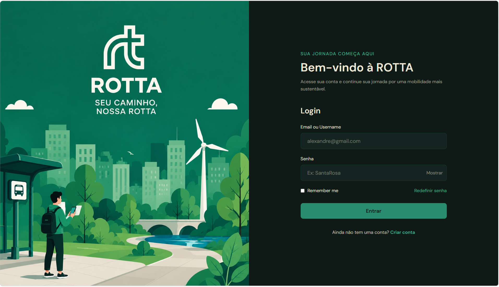

### Cadastro

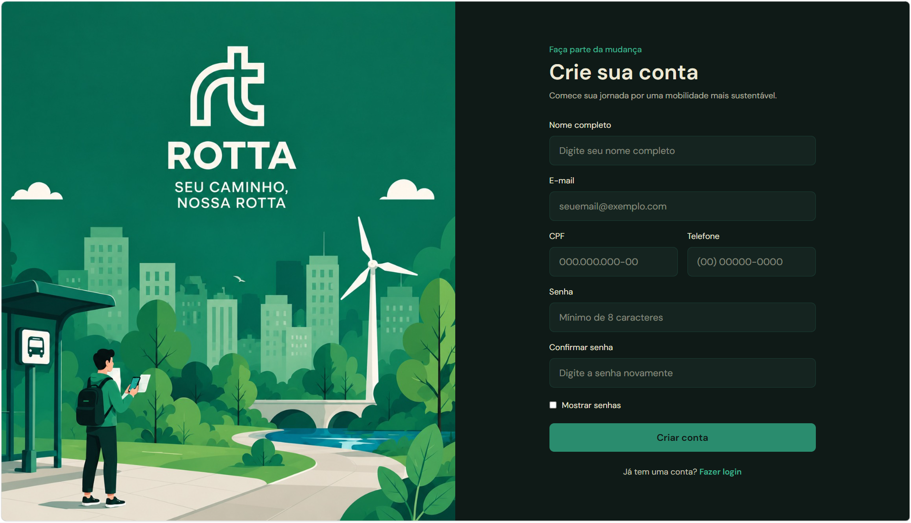

### Redefinir Senha

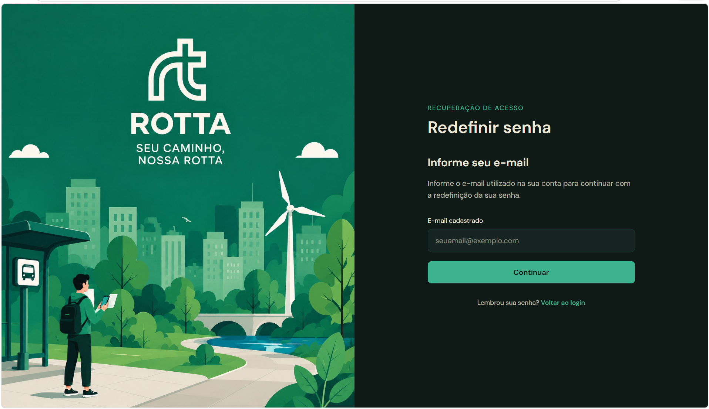

### Home

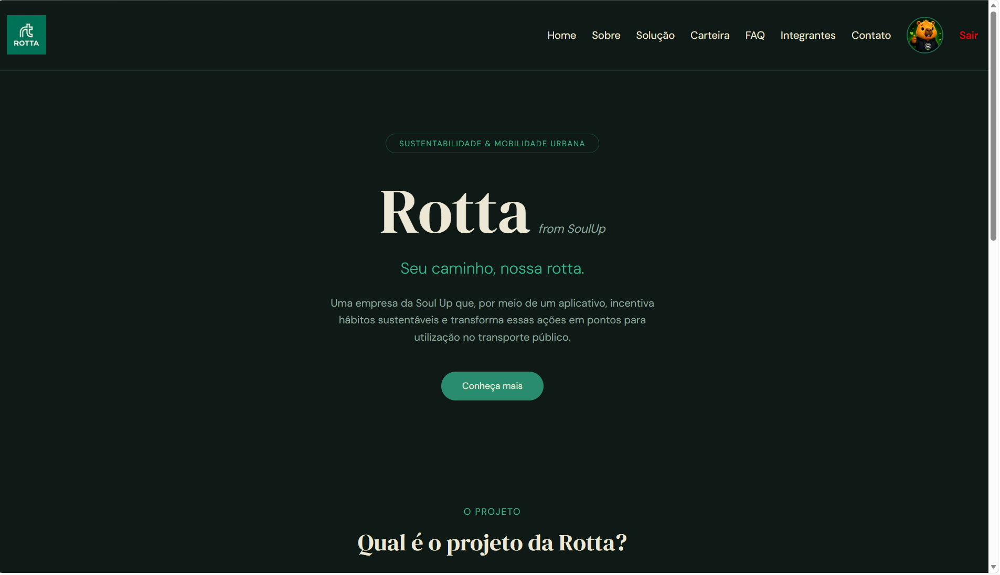

### Sobre

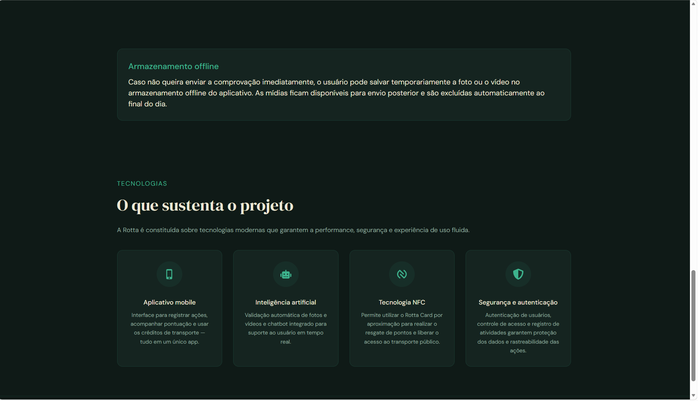

### Solução

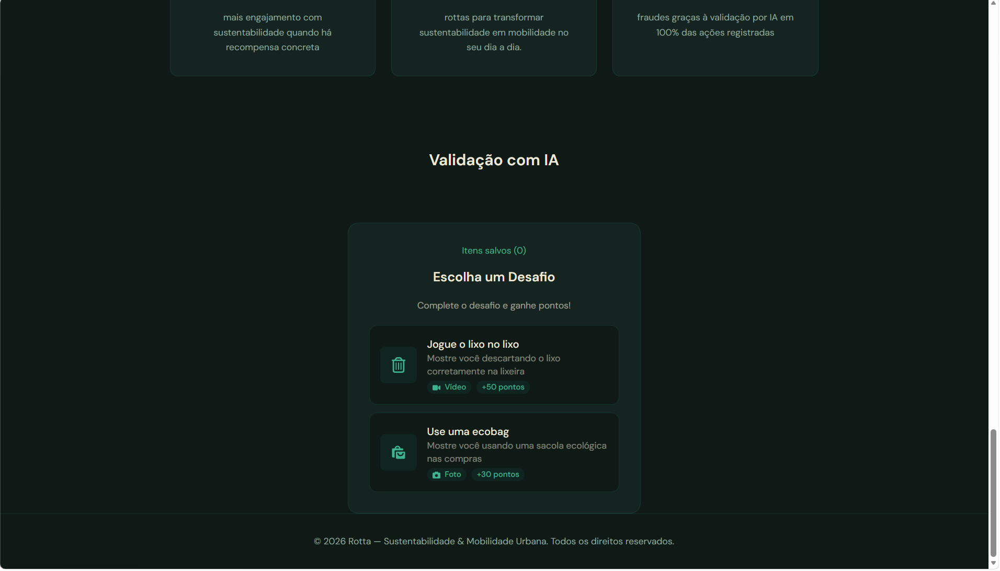

### Carteira

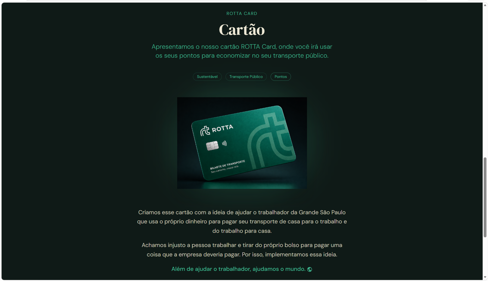

### FAQ

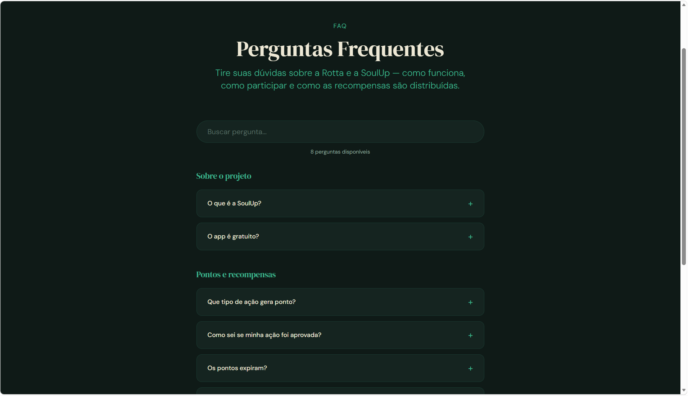

### Integrantes

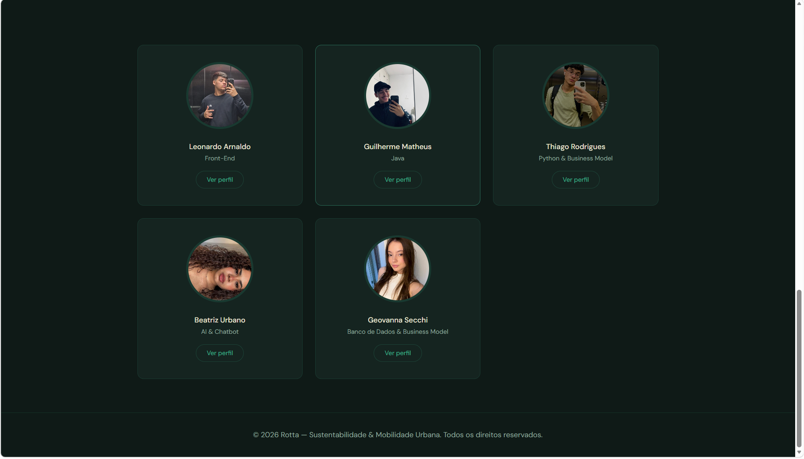

### Contato

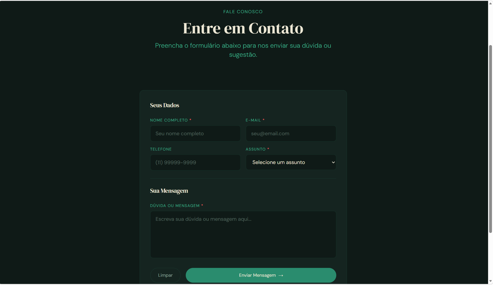


---

## 📬 Contato

Para dúvidas, sugestões ou informações sobre o projeto, entre em contato com a equipe por meio dos nossos perfis no LinkedIn ou pelo repositório:

- **GitHub:** https://github.com/ROTTA-SoulUP/rotta-frontend

  

<p align="center">
  <strong>🌱 ROTTA — e não se esqueça, seu caminho, nossa rotta.</strong>
</p>